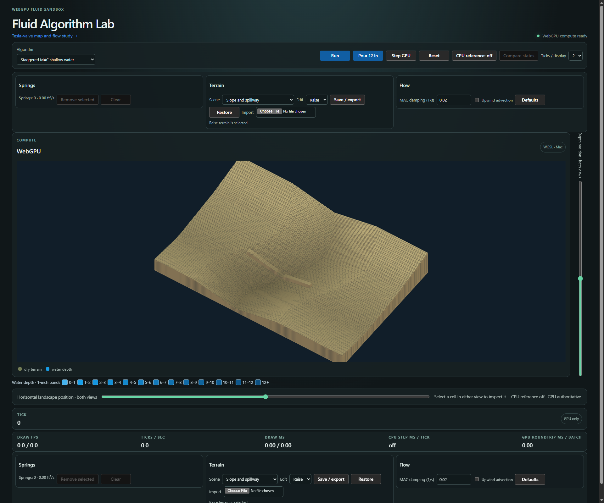
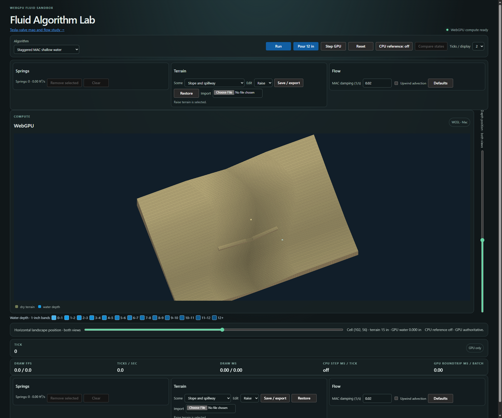
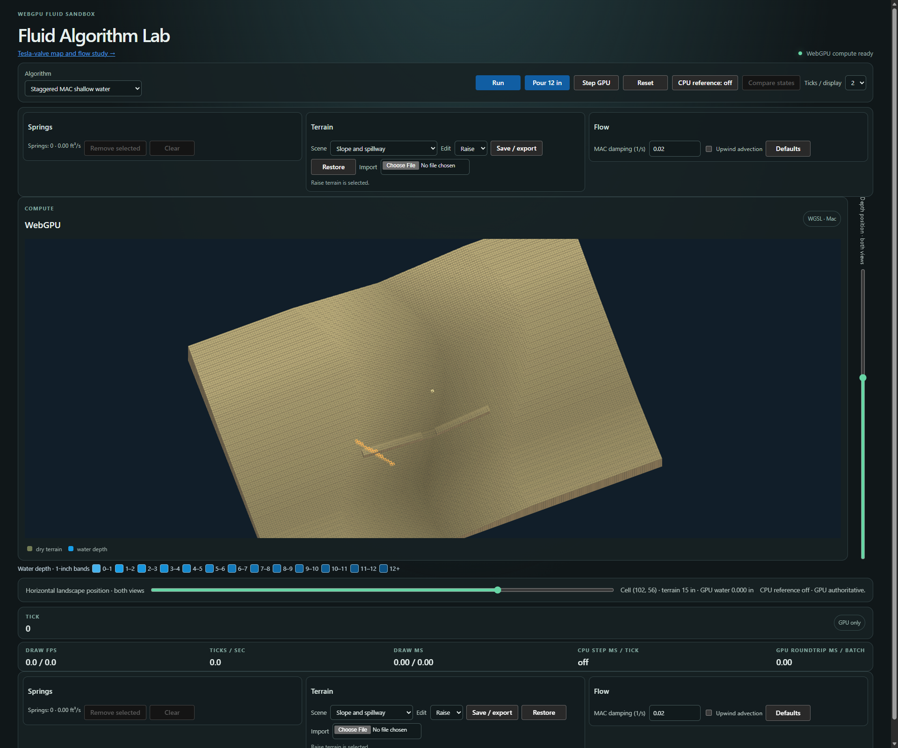

# WebGPU Reference Application Behavior

This document records the behavior of the deployed reference application at
<https://dorian-klingenberg.github.io/watershed/> for the native Direct3D 12
parity work in PR #11. The live app was opened in headless Edge 157 on
2026-11-20 with software WebGPU enabled (`--enable-unsafe-swiftshader`); the
app reported `WebGPU compute ready`. Its deployed
`wwwroot/js/landscape-view.js` matches the repository copy after normalizing
line endings. Screenshots below are captures of the live page at a 1920 x 1600
CSS-pixel viewport.

## Screenshots

The default screenshot shows the complete single-GPU-view page with CPU
reference disabled. The following captures show a terrain selection, orbit,
anchored zoom, barrier preview and commit, and a spring added by right-click.










## Visible application

The page is named **Fluid Algorithm Lab**. It contains:

- An engine status indicator. The tested browser reported `WebGPU compute ready`.
- Simulation controls for algorithm selection, Run/Pause, Pour 12 in, Step,
  Reset, CPU reference enable/disable, state comparison, and ticks per display.
- Spring controls showing source count and total flow, plus Remove selected and
  Clear.
- Terrain controls for the scene, Raise/Carve tool, map Save/export, Restore,
  and JSON Import. The parameter panel is rendered in two places in the page;
  both copies operate on the same simulation state.
- Algorithm-specific flow settings. Staggered MAC exposes the optional Upwind
  advection checkbox. Defaults restores the current algorithm's settings.
- A Tesla flow experiment panel when the Tesla scene is selected: Forward,
  Reverse, Advance 128 ticks, discharge/bypass readouts, and paired samples.
- One or two terrain views. Turning the CPU reference off hides the CPU view and
  leaves the GPU view visible. Both views share camera position, selection,
  hover, springs, and terrain changes.
- A depth-band legend, horizontal and vertical landscape-position sliders,
  cell inspection text, tick and throughput counters, and CPU/GPU rendering and
  timing summaries.

The visible terrain presentation is drawn by `landscape-view.js` with Canvas
2D. WebGPU computes the fluid state and supplies water snapshots to that
presentation. The scene is projected from terrain columns; it is not a native
WebGPU canvas renderer. The current camera does not expose roll. The app has
azimuth, elevation, zoom, and a 3D focus point that shifts when the user orbits
or zooms around a picked location.

## Mouse and pointer controls

Mouse gestures operate on either enabled terrain canvas. A gesture starts only
when its pointer-down position ray-picks a terrain column; blank background
does not start a gesture. The canvas captures the pointer until release or
cancellation, and suppresses the browser context menu.

| Input | Observed behavior |
| --- | --- |
| Left click / tap | Selects the picked terrain cell and shows its coordinates, height, spring rate if present, GPU water depth, and CPU water depth when the CPU reference is enabled. |
| Left drag | Once movement exceeds 5 CSS pixels, anchors the camera to the exact 3D terrain hit under the initial press, then orbits from the starting orientation. Horizontal movement changes azimuth by `0.008` radians per CSS pixel. Vertical movement changes elevation by `0.006` radians per CSS pixel, clamped to `0.25..1.4` radians. Releasing ends the orbit; it does not select a cell. |
| Right click / tap | Adds one spring-flow increment to the picked cell. Repeating the action at that cell increases its rate until the simulation's per-source maximum. The observed first increment was `0.25 ft³/s`. |
| Right drag | Samples terrain hits along the pointer path, connects neighboring hits into a cell stroke, and displays the pending stroke in orange. On release, the stroke is raised by 12 inches or carved by 12 inches according to the Raise/Carve selector. Canceling the gesture discards the pending edit. |
| Mouse wheel over terrain | Picks the terrain point under the pointer, moves the camera focus to that exact hit, and applies exponential zoom: `zoom *= exp(-clamp(pixelDelta, -500, 500) * 0.0015)`, clamped to `0.4..12`. Line-mode deltas are converted using 16 pixels per line; page-mode deltas use the view height. Negative `deltaY` zooms in. |
| Mouse wheel over blank view space or outside a view | Does not change the camera. Because the event is not consumed without a terrain hit, normal page scrolling may occur. |
| Drag outside the canvas | Does not begin a landscape gesture. The page can scroll normally. |

Touch uses pointer events with `touch-action: none` on the canvases: a single
touch tap selects and a single-touch drag follows the left-drag orbit path.
Right-button spring and barrier actions are mouse-only. Pointer cancellation
and lost pointer capture discard an uncommitted right-drag stroke.

There are no camera keyboard shortcuts. Horizontal and vertical range controls
below/right of the view move the shared camera focus along the terrain X and Y
axes. These sliders cancel an active pointer gesture. The camera has no UI
reset button; changing terrain or algorithm preserves camera position.

## Projection, picking, and pivot rules

The reference uses an orthographic column projection. Let `dx`, `dy`, and `dz`
be the world point relative to the camera focus, with azimuth `a`, elevation
`e`, and `scale = min(viewWidth, viewHeight * 1.45) * 0.88 / span * zoom`:

```text
depth   = -sin(a) * dx + cos(a) * dy
screenX = anchorX + (cos(a) * dx + sin(a) * dy) * scale
screenY = anchorY + (sin(e) * depth - cos(e) * dz) * scale
```

Consequently screen Y grows downward. At azimuth zero, increasing world Y
moves terrain downward on screen. Elevation uses the same sign in projection,
ray picking, and mouse response: dragging downward increases elevation.

Picking inverts the screen projection into a ray and intersects the terrain
column AABBs. The selected hit contains world X/Y/Z, not only a cell center.
Orbit and wheel zoom set the camera focus to that hit and retain the pointer's
normalized screen position as the projection anchor. This is why a picked
surface point stays at the cursor during the camera change. Orbit sensitivity
is independent of canvas backing-store pixel ratio and uses CSS pixels.

Initial camera values are azimuth `-0.6` rad, elevation `0.85` rad, zoom `1`,
and anchor `(0.5, 0.5)`. Camera X/Y begin at the field center; camera Z begins
at the midpoint of the initial terrain's scaled min/max heights.

## State-change rules relevant to parity

- Selecting a different fluid algorithm pauses the run, clears fluid and
  per-face state, resets ticks, and preserves terrain and camera.
- Selecting a terrain scene pauses and resets fluid, ticks, and forcing while
  preserving camera position.
- Raise/Carve and spring edits update the authoritative model and GPU inputs;
  terrain edits preserve the water depth already held in each cell.
- The Pour button uses the scene's configured pour location. Mouse right-click
  adds a spring; it is not the Pour command.
- CPU reference off stops CPU stepping/drawing and leaves WebGPU authoritative.
  Turning it back on reads GPU state into a new CPU comparison baseline.
- Save/export writes a versioned terrain map; import validates and loads the
  terrain (and supported spring data), clears fluid, and preserves the camera.
- Run advances batches paced by display opportunities. The batch selector
  controls 1, 2, 4, or 8 ticks per display; Step advances one tick. Hidden tabs
  suspend the run loop, and Pause waits for in-flight work to complete.

The canonical implementation details live in
[landscape-view.js](../projects/grannys-house-trials/webgpu-fluid-sandbox/wwwroot/js/landscape-view.js),
the app UI and state transitions in
[Home.razor](../projects/grannys-house-trials/webgpu-fluid-sandbox/Pages/Home.razor),
and the broader architecture in
[the WebGPU sandbox README](../projects/grannys-house-trials/webgpu-fluid-sandbox/README.md).
