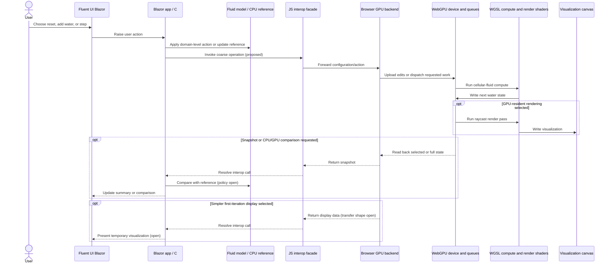
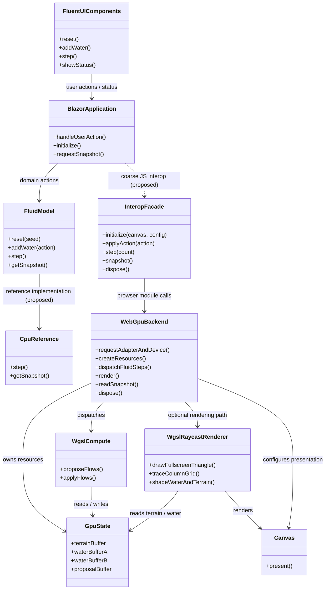

# WebGPU Fluid Sandbox — Architecture Decisions

This is the decision ledger for the browser-based fluid simulation workbench. It
records the planning decisions and the initial implementation choices. The
project lives in this directory as a clean, independent application with no code
dependencies on the existing Granny's House Trials work. Existing experiments
are references for behavior and lessons only.

## Decision Ledger

### ADR-001: Build a browser fluid-simulation workbench

- **Status:** Accepted direction
- **Decision:** Explore a browser-based sandbox for Granny's garden fluid
  simulations.
- **Reason:** The user wants a browser platform relevant to their clients'
  Blazor experience and a place to grow fluid simulations over time.
- **Scope guard:** Begin with the cellular-fluid experiment. More advanced fluid
  simulations can come later.

### ADR-002: Use Blazor WebAssembly for the application shell

- **Status:** Accepted direction
- **Decision:** Use Blazor WebAssembly, with Fluent UI Blazor controls arranged
  around the WebGPU visualization pane.
- **Constraints:** Keep browser JavaScript interop as limited as practical. Dear
  ImGui is not the intended UI.
- **Implementation:** Fluent UI buttons sit above side-by-side CPU and GPU field
  views.

### ADR-003: Keep the project independent of prior implementations

- **Status:** Accepted direction
- **Decision:** The new project should live in a clean, separate location and
  have no code dependencies on prior work.
- **Clarification:** Existing code, renderer behavior, shaders, and measurements
  may be studied and recreated; they are references, not dependencies.
- **Implementation:** The approved implementation lives in this directory. The
  name remains provisional.

### ADR-004: Isolate browser GPU concerns from domain concepts

- **Status:** Accepted and implemented
- **Decision:** Treat the GPU API and browser GPU resource management as a
  platform boundary, not as the home for domain concepts.
- **Direction:** Domain concepts should not become trapped in JavaScript.
  Blazor/C# is the expected place for application and domain-facing code; a
  browser-side module is the expected place for WebGPU interactions.
- **Interop constraint:** Prefer a small number of coarse operations over
  per-cell or per-frame interop.
- **Implementation:** C# owns the domain-facing model, CPU reference, actions,
  statistics, and comparison. A coarse JavaScript interop module owns WebGPU
  resources and dispatch. WGSL contains the numeric operations required by the
  GPU kernel, not application-domain concepts.

### ADR-005: Start by recreating the cellular-fluid experiment

- **Status:** Accepted direction
- **Decision:** Recreate the existing cellular-fluid experiment before trying
  more advanced fluid models.
- **Scope:** Focus on the fluid simulation itself and only the minimum useful
  interactivity for a first platform iteration.
- **Controls:** Reset, pour water at the center, step both implementations once,
  and request a CPU/GPU comparison.
- **Boundary behavior:** Drain water from the outer grid cells after each tick,
  matching the initial experiment's open-edge behavior.
- **Reference:** Include the C# implementation in the first slice. Compare every
  cell with a `0.0001` absolute tolerance on explicit request.
- **Deferred:** MAC-grid and other advanced fluid simulations.

### ADR-006: Revisit the existing renderer before deciding the WebGPU rendering path

- **Status:** Review finding; first-iteration choice implemented
- **Finding:** The existing renderer is unconventional. It draws a full-screen
  triangle, reconstructs a camera ray per pixel, and uses a pixel shader to
  traverse a grid of variable-height columns with DDA. It does not first build a
  conventional terrain mesh.
- **Fluid representation:** Terrain height and fractional water depth are
  separate. Rendering derives the water surface from both and shades wet
  columns using water depth.
- **GPU precedent:** The existing Phase 1 compute experiment reads results back
  for the existing renderer. Phase 2 keeps water GPU-resident and renders from
  GPU terrain and water buffers, using snapshots for inspection or edits.
- **Implementation:** Use a regular 2D cell map for the first visible iteration.
  The GPU field is read back for drawing after a manual step; raycast rendering
  is deferred.

### ADR-007: Browser target and success criteria

- **Status:** Initial direction implemented; broader criteria remain open
- **Decision:** Chrome is acceptable as the initial browser target.
- **Success criteria:** Intentionally undefined for now. The user wants to see
  an early iteration before deciding what visual and interaction qualities are
  right.

### ADR-008: Separate algorithms from scenarios and execution backends

- **Status:** Accepted and implemented
- **Decision:** Offer Cellular, Pipe-flux shallow water, Terrain-head pipe flow,
  and staggered MAC shallow water in the existing landscape on both CPU and GPU.
  Historical cellular optimization variants are not separate physics choices.
- **State:** C# owns algorithm identity, fixed-step/unit policy and independent
  reference depth plus all signed face state. WGSL reproduces those equations.
  Cellular uses two passes; momentum models use edge proposal, donor-budget
  limiting, then depth divergence/state commit. Enabled MAC advection adds a
  preceding velocity pass into existing edge scratch storage. Face state is shared on each
  interior east/south edge; exterior faces are implicit zero.
- **Lifecycle:** Switching pauses and clears all fluid/ticks, preserving current
  terrain and camera. Reset retains algorithm but restores starting terrain.
  Terrain edits clear incident face state. Complete GPU baselines contain depth,
  face state, tick and algorithm; recovery/re-enable import them atomically.
  Comparison validates identity and checks depth and face values: cellular
  retains 0.0001 in depth tolerance; momentum models use 0.002 in depth and
  0.002 ft³/s pipe-rate or 0.002 ft/s MAC-velocity tolerance. Depth/face mismatch
  counts and maximum errors stay separate, not mixed across units.
- **Limits:** Fixed 0.016 s momentum ticks, local Courant speed cap and 25% donor
  budget target ordinary pours, not arbitrary flood magnitudes. Terrain crests
  are overtoppable, never absolute-height walls. Additional historical models
  and erosion remain deferred.
  See README for equations, units and deliberate departures from C++ references.
- **Fidelity:** The momentum solvers are adapted recreations, not exact C++ ports.
  The browser uses its own documented timestep, pipe area, friction and shared-edge
  storage; C#/WGSL comparisons validate matching browser equations, not the old
  executable's trajectories or byte-identical floating-point results. Pours retain
  face impulse; terrain edits invalidate only changed cells' incident faces.

### ADR-009: Validated settings and controlled terrain experiments

- **Status:** Accepted and implemented
- **Decision:** Keep immutable validated per-algorithm settings and terrain/forcing
  policies in C#. Expose only relevant knobs; restore defaults for the current
  algorithm. Any setting change pauses and clears full fluid state, preserving
  terrain/camera. Complete-state baselines include settings identity.
- **MAC:** Optional first-order upwind staggered velocity advection is real in
  both implementations. It precedes pressure/drag and the existing positivity
  and local speed limits; default remains off. A separate GPU advection pass
  avoids pathological SwiftShader compilation from inlining a staggered stencil
  inside the dynamic momentum-axis loop, without extra persistent state.
- **Scenes:** Slope, enclosed basin, water slide, and a six-return Tesla channel.
  Scene selection pauses/replaces terrain/clears fluid; Reset restores the selected
  scene. Camera remains presentation-owned and unchanged.
- **Experiment:** C# generates uniform initial wetting and fixed-head numeric
  reservoir operations (18/12 in or 12/18 in), not JavaScript scene logic. The
  channel bottom is flat and reservoirs comparable; six alternating hooked
  returns connect to the main path. Kernels clamp prescribed depths after every
  tick; CPU-off does not execute or snapshot reference state.
- **Measurements:** C# defines signed face probes; the backend reads actual
  limited transfers, applies probe weights, and returns only two scalar rates.
  Transfer scratch is read back only while forcing is active; ordinary batches
  retain the depth/face-state-only readback. Main-channel discharge and bypass throughput are final-tick measurements, not
  circulation/vorticity or steady-state estimates. Equal-tick directional samples
  can differ without implying check-valve closure or guaranteed resistance.
  Momentum models report ft³/s using their 0.016-s tick; Cellular has no physical
  time calibration and reports transferred ft³ per algorithmic tick instead.
  README records measured forward/reverse observations and model limitations.

## Implemented architecture

The following is the current implementation, not a finalized performance
architecture:

- `Simulation/CellularFluidSimulation.cs` owns the C# terrain, water state,
  four-algorithm reference and face state, point pours, barrier height policy, reset, and summary.
- `Pages/Home.razor` serializes paired ticks and edits, owns Run/Pause, and
  displays selected-cell information. Camera navigation remains usable while paused.
- `wwwroot/js/landscape-view.js` owns projected height-column drawing, terrain
  picking, linked camera/navigation, and gesture previews. Committed cell edits
  are dispatched to C#; it does not own fluid or terrain-edit rules.
- `wwwroot/js/fluid-gpu.js` owns WebGPU resources and executes the WGSL
  two cellular or three momentum passes, plus the optional MAC advection pass.
  GPU depths stay in ping-pong buffers
  and persistent face state in a separate buffer between actions.
- Reset uploads the complete starting field. Pours send additive edits, preserving
  each active implementation's independent water state. Barrier strokes update terrain
  without replacing water. Each display batch reads GPU water back once for drawing.
- After each tick, water on the field's outer boundary is drained.
- `Compare states` requests the cached completed GPU snapshot across interop and compares it to the
  C# snapshot, reporting mismatch count, maximum cell error, and water-total
  error.
- When WebGPU cannot initialize, the C# reference remains available. GPU failure
  restores the last completed display baseline/tick before activating CPU fallback;
  an unrecoverable baseline explicitly resets, never resumes stale reference water.
- The CPU reference toggle skips solver stepping, water snapshots, drawing, and
  summary scans while off. C# retains domain/terrain/edit policy. Re-enabling uses
  a fresh GPU readback and its tick as an explicitly announced new baseline;
  subsequent edits/steps remain independent, not ongoing synchronization.
- Both views share selection, hover, camera, and two-axis landscape navigation.
  The depth-axis slider sits physically to the right of the views. Vertical
  page scrolling and responsive layout keep controls reachable on small screens.
- The sloped scene and barriers are reusable across future solver experiments;
  momentum-based waves are available in the three non-cellular algorithms.
- `tests/FluidModelChecks` exercises conservation, flow, repeatability, boundary
  pours, input validation, and comparison behavior.
- `.github/workflows/deploy-webgpu-fluid-sandbox.yml` publishes the static app to
  GitHub Pages.
- A serialized display-paced loop replaces the fixed tick delay. Configurable
  1/2/4/8-tick batches amortize one GPU readback; manual Step remains one tick.
  CPU delta storage, unchanged terrain, projected geometry, and column order are
  reused. Only dirty, visible, enabled canvases redraw.
- Pause/disposal cancel and resolve pending display waits before awaiting the run
  loop; visibility changes also resolve waits so a suspended animation frame
  cannot strand component disposal. Reset commits cached water/terrain/tick only
  after upload completion; a failed partial reset invalidates recovery and
  explicitly resets CPU state. Backend view sessions serialize old-page disposal
  and new-page initialization so asynchronous cleanup cannot clear remounted views.
- Terrain/water edits invalidate recovery before queued writes begin and restore
  validity only after queue completion. A partially failed edit explicitly resets
  fallback instead of pairing old cached depths with newly edited terrain/face state.
- Actual redraw FPS, ticks/sec, draw cost, CPU step cost, and GPU dispatch/readback
  wall-clock roundtrip are sampled every 500 ms. The latter is not GPU execution
  time. Selection reads cached display depths without another GPU map or full
  snapshot transfer to C#.
- Dedicated message-passing workers are feasible on static hosting without shared
  memory; moving the C# runtime or WebGPU device into one needs a separate ownership
  and bootstrap design. Shared-memory/WASM threads require cross-origin isolation,
  which this Pages workflow does not configure. No worker or parallel mixed-solver
  architecture is required here; see README for the hosting assessment.

The earlier diagrams below are conceptual planning sketches; the current
implementation boundary is described above and in [README.md](./README.md).

## Historical architecture sketches

These original planning sketches are retained for decision history. They are
not the implementation contract; see the preceding implementation summary and
the project README for the current architecture.

### Interaction sequence: Blazor/C# and browser GPU boundary

The detailed call granularity and state ownership in this historical sketch are
superseded by the implemented architecture above.

### Main component class diagram

The component names and operations in this historical sketch are conceptual.
The current browser adapter is plain JavaScript; WGSL is used for WebGPU compute.

## References Reviewed

These existing files informed the rendering and simulation review. The proposed
browser project does not depend on them:

- `projects/grannys-house-trials/subprojects/grass-field-003/shaders/grass_field_renderer.hlsl`
- `projects/grannys-house-trials/subprojects/grass-field-003/shaders/fluid_compute_phase1.hlsl`
- `projects/grannys-house-trials/subprojects/grass-field-003/lesson_experiment_cellular_fluid_sim.md`
- `projects/grannys-house-trials/subprojects/grass-field-003/lesson_experiment_cellular_fluid_hlsl_compute_phase1.md`
- `projects/grannys-house-trials/subprojects/grass-field-003/lesson_experiment_cellular_fluid_hlsl_compute_phase2_tiled_resident.md`
- `projects/grannys-house-trials/subprojects/grass-field-003/LESSON_CATALOG.md`
