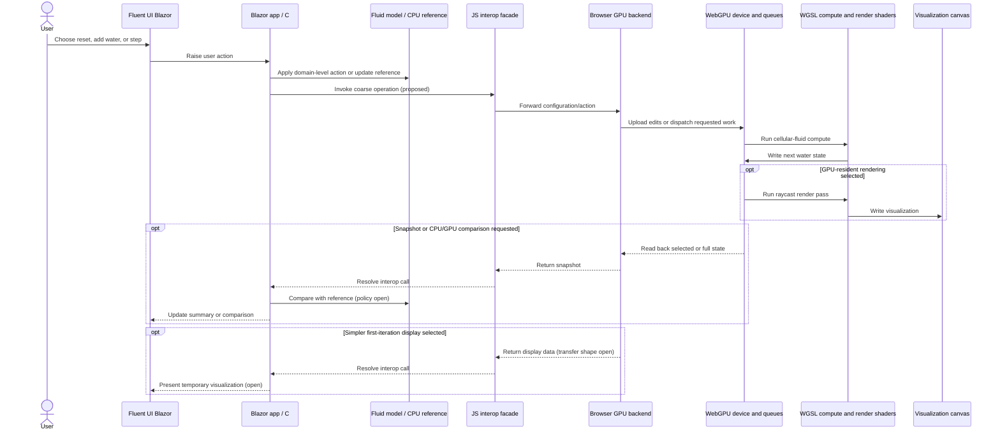
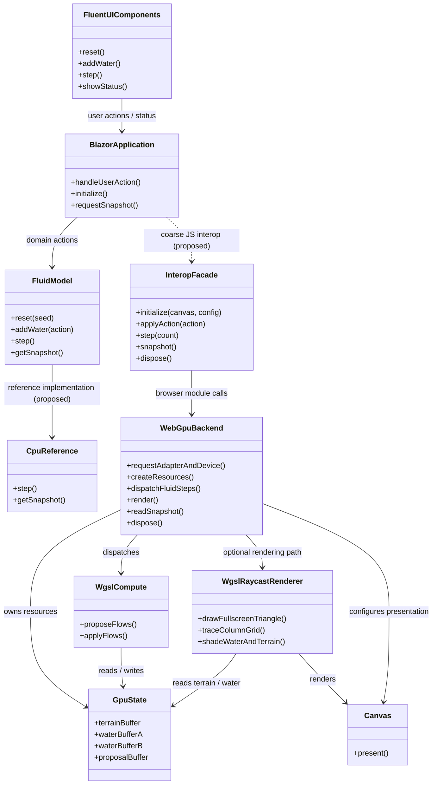

# WebGPU Fluid Sandbox — Architecture Decisions

This is the running decision ledger for the proposed browser-based fluid
simulation workbench. It records decisions and working assumptions from planning;
it does not authorize implementation. The project is intended to have a clean,
independent home and no code dependencies on the existing Granny's House Trials
work. Existing experiments are references for behavior and lessons only.

## Decision Ledger

### ADR-001: Build a browser fluid-simulation workbench

- **Status:** Accepted direction
- **Decision:** Explore a browser-based sandbox for Granny's garden fluid
  simulations.
- **Reason:** The user wants a browser platform relevant to their clients'
  Blazor experience and a place to grow fluid simulations over time.
- **Scope guard:** Begin with the cellular-fluid experiment. More advanced fluid
  simulations can come later.

### ADR-002: Use Blazor WebAssembly for the application shell

- **Status:** Accepted direction
- **Decision:** Use Blazor WebAssembly, with Fluent UI Blazor controls arranged
  around the WebGPU visualization pane.
- **Constraints:** Keep browser JavaScript interop as limited as practical. Dear
  ImGui is not the intended UI.
- **Open detail:** The exact control layout and component selection remain
  undecided.

### ADR-003: Keep the project independent of prior implementations

- **Status:** Accepted direction
- **Decision:** The new project should live in a clean, separate location and
  have no code dependencies on prior work.
- **Clarification:** Existing code, renderer behavior, shaders, and measurements
  may be studied and recreated; they are references, not dependencies.
- **Open detail:** The final project name and long-term repository location have
  not been confirmed. This directory is a planning location only.

### ADR-004: Isolate browser GPU concerns from domain concepts

- **Status:** Accepted boundary; implementation details open
- **Decision:** Treat the GPU API and browser GPU resource management as a
  platform boundary, not as the home for domain concepts.
- **Direction:** Domain concepts should not become trapped in JavaScript.
  Blazor/C# is the expected place for application and domain-facing code; a
  browser-side module is the expected place for WebGPU interactions.
- **Interop constraint:** Prefer a small number of coarse operations over
  per-cell or per-frame interop.
- **Open detail:** The precise division of canonical simulation behavior,
  compute-kernel behavior, GPU state ownership, and C# reference behavior needs
  further discussion.

### ADR-005: Start by recreating the cellular-fluid experiment

- **Status:** Accepted direction
- **Decision:** Recreate the existing cellular-fluid experiment before trying
  more advanced fluid models.
- **Scope:** Focus on the fluid simulation itself and only the minimum useful
  interactivity for a first platform iteration.
- **Candidate controls:** Reset, add a small center pour, and step the
  simulation. These are suggestions, not a final control specification.
- **Deferred:** MAC-grid and other advanced fluid simulations.

### ADR-006: Revisit the existing renderer before deciding the WebGPU rendering path

- **Status:** Review finding; first-iteration choice open
- **Finding:** The existing renderer is unconventional. It draws a full-screen
  triangle, reconstructs a camera ray per pixel, and uses a pixel shader to
  traverse a grid of variable-height columns with DDA. It does not first build a
  conventional terrain mesh.
- **Fluid representation:** Terrain height and fractional water depth are
  separate. Rendering derives the water surface from both and shades wet
  columns using water depth.
- **GPU precedent:** The existing Phase 1 compute experiment reads results back
  for the existing renderer. Phase 2 keeps water GPU-resident and renders from
  GPU terrain and water buffers, using snapshots for inspection or edits.
- **Open detail:** Decide whether the first visible iteration should reproduce
  the raycast renderer or use a simpler temporary display while validating
  compute.

### ADR-007: Browser target and success criteria

- **Status:** Initial direction accepted; criteria open
- **Decision:** Chrome is acceptable as the initial browser target.
- **Success criteria:** Intentionally undefined for now. The user wants to see
  an early iteration before deciding what visual and interaction qualities are
  right.

## Current Architecture

The following is the current **planning model**, not a finalized implementation
contract. Solid direction reflects user decisions; dashed notes reflect
implementation details still under discussion.

### Interaction sequence: Blazor/C# and browser GPU boundary

The call granularity and state ownership shown here are proposed. In particular,
the first iteration has not yet chosen between a GPU-resident rendering path and
a CPU-visible compatibility path.

### Main component class diagram

The component names and operations are conceptual. TypeScript is the current
language recommendation for the browser module, not a confirmed choice. WGSL is
the expected WebGPU shader language if WebGPU is used.

## References Reviewed

These existing files informed the rendering and simulation review. The proposed
browser project does not depend on them:

- `projects/grannys-house-trials/subprojects/grass-field-003/shaders/grass_field_renderer.hlsl`
- `projects/grannys-house-trials/subprojects/grass-field-003/shaders/fluid_compute_phase1.hlsl`
- `projects/grannys-house-trials/subprojects/grass-field-003/lesson_experiment_cellular_fluid_sim.md`
- `projects/grannys-house-trials/subprojects/grass-field-003/lesson_experiment_cellular_fluid_hlsl_compute_phase1.md`
- `projects/grannys-house-trials/subprojects/grass-field-003/lesson_experiment_cellular_fluid_hlsl_compute_phase2_tiled_resident.md`
- `projects/grannys-house-trials/subprojects/grass-field-003/LESSON_CATALOG.md`
