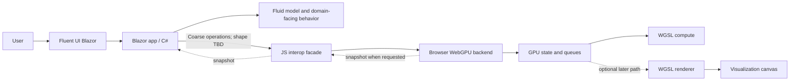
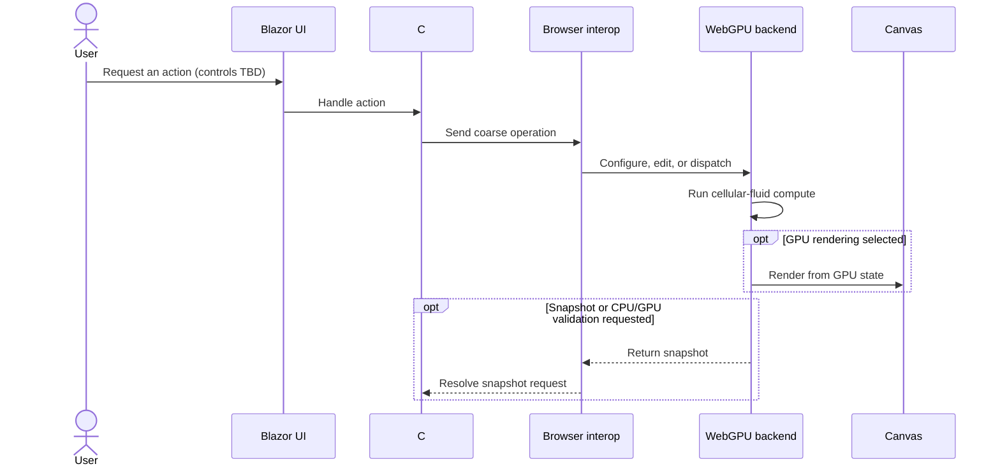

# WebGPU Fluid Sandbox

> **Planning workspace only — not an implementation.** This folder captures the direction, decisions, and open questions for a possible browser-based cellular-fluid simulation workbench. It does not authorize building the application, and the final project name and long-term location are still undecided.

## At a glance

The proposed workbench explores whether a small fluid simulation can run in a browser using **Blazor WebAssembly** for the application shell and **WebGPU** for GPU work. The first focus is recreating the existing cellular-fluid experiment—not building a general-purpose fluid platform.

The aim is to see an early, interactive iteration and then decide what visual and interaction qualities matter. Success criteria are intentionally not fixed in advance.

| Direction | Current planning status |
| --- | --- |
| Browser application with Blazor WebAssembly | Accepted direction |
| Fluent UI Blazor controls around a visualization pane | Accepted direction; layout open |
| Cellular-fluid experiment first | Accepted direction |
| Chrome as the initial browser target | Accepted direction |
| Small, coarse-grained C#–browser GPU boundary | Preferred constraint; details open |
| TypeScript for the browser module | Recommendation only |
| First rendering path and CPU/GPU comparison policy | Open |
| Project name and permanent location | Open |

## First slice

Keep the first iteration focused on platform feasibility and the cellular-fluid simulation:

- Get a fluid simulation running in the browser.
- Keep interaction minimal. Reset, a small center pour, and manual stepping are candidate controls, not a finalized specification.
- Use regular rendering first while establishing a good simulation; revisit the existing column-raycast approach later.
- Keep the project independent of previous implementations. Existing code and measurements are references to study and recreate, not dependencies.

Advanced models such as MAC-grid simulation, a broad sandbox workflow, and GPU-resident rendering refinements are later considerations—not first-slice commitments.

## Conceptual boundary

The current planning model places application and domain-facing concepts in C#, while browser GPU resource management and WebGPU calls live behind a small browser-side module. Interop should happen through coarse operations rather than per-cell or per-frame crossings. Exactly how canonical simulation behavior, WGSL compute, CPU reference behavior, and GPU state ownership fit together remains an open design question.

This diagram is a discussion aid, not a finalized implementation contract. GPU ownership, snapshot timing, and the CPU reference's role are still open.

## Simulation and display loop (proposed)

The simplest useful interaction may be a user-requested reset, pour, or step, followed by GPU work and a visible result. The exact operation contract and display path remain to be decided.

## Rendering context

The existing experiment is useful as behavioral and rendering reference, but it is not a dependency. Its renderer uses a full-screen triangle and a pixel-shader raycast that traverses variable-height columns with DDA, rather than first building a conventional terrain mesh. Terrain height and fractional water depth are separate inputs to the derived water surface and shading.

The first browser iteration is currently directed toward **regular rendering** while the simulation is established. Recreating the column-raycast renderer in WGSL may be explored later. The existing work also provides two GPU precedents—readback for a separate renderer, and GPU-resident water with snapshots for inspection—but neither is yet the chosen browser architecture.

## Open decisions

The companion planning documents hold the full decision history. The main unresolved choices include:

- The minimum useful controls and first Fluent UI layout.
- The C# / browser GPU contract and active simulation-state ownership.
- Whether a CPU reference is included in the first version and how it is used.
- How CPU and GPU results should be compared (for example, tolerance, exact values, or invariants).
- When GPU snapshots are transferred to the application.
- Whether the browser module uses TypeScript or JavaScript.
- What makes the first visible iteration successful, after it can be reviewed.
- The final project name and permanent location.

## Planning documents

- [Architecture decisions](./ARCHITECTURE_DECISIONS.md) — decision ledger, conceptual diagrams, rendering review, and current planning model.
- [Questions and answers](./QUESTIONS_AND_ANSWERS.md) — recorded clarifications and remaining questions.
- [Deferred to-do ledger](./DEFERRED_TODO.md) — work and decisions explicitly deferred; nothing there authorizes implementation.

## Guardrails

- Treat this folder as planning, not permission to implement.
- Keep the first effort narrow: browser feasibility and cellular fluid first.
- Recreate behavior from prior work without taking code dependencies on it.
- Keep domain concepts out of the browser GPU module.
- Keep interop coarse-grained; avoid per-cell or per-frame crossings.
- Leave success criteria open until an early iteration is available to assess.
