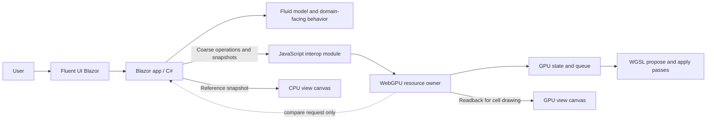
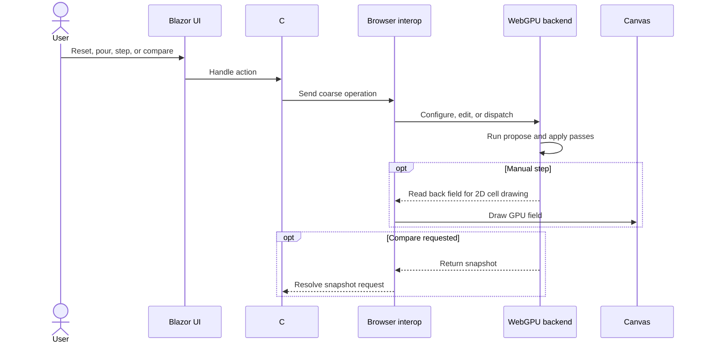

# WebGPU Fluid Sandbox

This directory now contains the first runnable implementation of the browser-based cellular-fluid workbench. It is a standalone Blazor WebAssembly application and has no code dependencies on the existing Granny's House Trials experiments; those experiments remain behavioral references only.

## At a glance

The workbench runs four fluid algorithms using **Blazor WebAssembly** for the application shell and **WebGPU** for compute, with a matched C# reference for each.

The aim is to make an early interactive iteration available for review. Broader success criteria and future simulation scope remain open.

| Direction | Current status |
| --- | --- |
| Browser application with Blazor WebAssembly | Implemented |
| Fluent UI Blazor controls around a visualization pane | Implemented |
| Cellular-fluid experiment first | Implemented |
| Chrome as the initial browser target | Supported target |
| Small, coarse-grained C#–browser GPU boundary | Implemented |
| C# CPU reference and GPU comparison | Implemented |
| JavaScript WebGPU backend with WGSL compute | Implemented |
| Linked height-aware CPU/GPU landscape views | Implemented with projected Canvas2D columns |
| GitHub Pages static deployment | Workflow included |

## First slice

The first implementation focuses on platform feasibility and the cellular-fluid simulation:

- Run/pause the GPU with an optional CPU reference, or manually advance one tick.
- Explore a downhill channel, lower collecting area, and a barrier with a lower spillway.
- Pour water uphill with the toolbar, or at a hovered cell with a right click.
- Draw additional barriers with right-drag; reset restores the starting terrain and clears water.
- Run the same synchronous cellular-flow rule in C# and WGSL.
- Let water leaving the grid drain from the four field boundaries.
- Compare CPU and GPU water snapshots on request using an absolute per-cell tolerance.
- Render linked height-aware landscapes with projected columns, retaining independent CPU/GPU water results.
- Keep the project independent of previous implementations. Existing code and measurements are references, not dependencies.

## Algorithms, scenario, and execution

The **Algorithm** selector changes the numeric model in both implementations.
The terrain selector offers slope/spillway, enclosed basin, water slide, and
single-stage Tesla channel; CPU/WebGPU are execution backends,
not different algorithms. Changing algorithm pauses Run and clears water, all
face state, and ticks while preserving **current edited terrain and camera**.
Reset instead restores starting terrain and clears fluid while retaining the
selected terrain and algorithm. CPU-only fallback supports all four.

| Algorithm | Persistent state and model |
| --- | --- |
| Cellular | Depth-only synchronous four-neighbor redistribution; configurable max flow (default 2 in/tick) and settle rate (0.5). No physical seconds per tick; experiment transfers are ft³/tick, never ft³/s. |
| Pipe-flux shallow water (adapted) | Signed edge volume rates, free-surface pressure impulse through configurable virtual pipes (default 0.25 ft²), retention (0.94/tick), old/new trapezoidal volume transport. |
| Terrain-head pipe flow (adapted) | Signed pipe volume rates and trapezoidal transport, but depth-dependent semi-implicit Manning-style rough-bed friction (n=0.04), rather than constant linear damping. Shallow flow loses more momentum than deep flow. |
| Staggered MAC shallow water (adapted) | Persistent face velocities, gravity impulse and configurable linear drag (default 0.02/s); donor-depth continuity flux, **not** fixed-pipe-area transport. Optional first-order upwind velocity self-advection is implemented in C# and WGSL (off by default). |

Only relevant settings appear for the current algorithm. Terrain-head exposes
pipe area and Manning roughness. Validated immutable C# settings are included in
complete baselines and comparison identity (along with active forcing direction). Changing any setting pauses and
clears fluid/ticks while preserving edited terrain and camera. Restore defaults
affects only the selected algorithm. Bounds are flow 0.01–12 in/tick, settle
0.01–1, areas 0.01–1 ft², retention 0–1, roughness 0.001–0.2,
and MAC damping 0–5/s; nonfinite/out-of-range values are rejected atomically.

MAC advection computes `q' = q - dt*(u*upwind_dx(q) + v*upwind_dy(q))`
on the staggered faces, interpolating the transverse velocity from four adjacent
faces. Missing/exterior faces are zero. Gravity, drag, local speed cap and donor
limiting then act on that advected velocity; depth transport remains upwind.
The GPU uses a separate optional advection pass into existing scratch storage
to keep real Chromium/SwiftShader pipeline compilation tractable.

The three momentum models use 1 ft cells, gravity 32.174 ft/s² and fixed
0.016 s ticks. Public/render depths and terrain are inches; pipe states are
ft³/s and MAC states ft/s. Two signed face values per cell represent east/south
interior faces; opposite directions share that face and external faces are
implicit zero. Momentum is a convenient label for these rate/velocity states,
not conserved mechanical momentum.

Hydrostatic crest reconstruction uses depth above the higher neighboring bed.
Dry high neighbors block flow until overtopped; **no terrain-height threshold
turns a cell into an absolute wall**. Equal free surfaces over varied beds stay
at rest. Pours add depth without clearing existing face impulse. Terrain edits
preserve volume and clear only faces incident to cells whose bed actually changed;
unaffected faces retain their state.
Transport shares a donor budget of at most 25% of its starting depth per tick,
scaling persistent face state by the same factor. A local wave-speed-based
velocity cap limits advective Courant number (0.45 minus gravity-wave
contribution); extreme depths exceeding that fixed-step budget stall rather
than claim a physically valid CFL step. Normal 12–72 in pours are the intended
range. This is an experimental positivity-limited approximation, not a
production flood solver, incompressible Navier–Stokes, or a calibrated erosion model.
Only outer grid cells drain; enclosed terrain basins conserve water.

Complete baseline exports/imports contain depths, **all face rates/velocities**,
algorithm identity, immutable settings and tick. Reference re-enable and device-loss recovery import
that complete state, not just depths. Each completed GPU display batch caches
both depth and face state together; there is still no CPU snapshot transfer or
solver/draw/summary work while the CPU reference is off. Comparison checks
algorithm/tick and every depth and face value. Cellular retains its original
0.0001 in absolute depth tolerance; momentum models use 0.002 in for depth and
0.002 ft³/s (pipes) or 0.002 ft/s (MAC) for face state. Depth/face mismatch
counts and maximum errors are reported separately, never combined across units;
water-total error is in cell-inches. Reference re-enable explicitly starts a new
independent baseline.

Boundary direction is validated identity, not an implicit scene restore.
Importing a forced baseline after Reset or into the opposite experiment is
explicitly rejected before any state changes. Re-establish the matching scene
and experiment direction before importing; same-direction re-enable/recovery
retains the existing prescribed reservoir constraints.

These are **adapted recreations, not exact ports or parameter-equivalent
reproductions** of the earlier pipe-flux, terrain-head and MAC headers and lesson
documents under `../subprojects/grass-field-003/`; none are dependencies. In
particular, original Terrain-head uses 0.005 s ticks, 0.05 ft² pipes and Manning
n=0.045, while this browser adaptation uses 0.016 s, 0.25 ft² and n=0.04.
Both retain old/new trapezoidal transport and depth-dependent friction. Original
Pipe-flux has separately stored mirrored directional fluxes in inch-based
experiment units; this adaptation stores each signed shared edge once in ft³/s,
with a physically dimensioned pressure impulse instead of the original tunable
pressure/conductance scaling. Its constant linear damping still distinguishes
it from Terrain-head's nonlinear rough-bed loss. Browser C#/WGSL comparisons
validate **these browser models against one another**, not equivalence to C++.
The browser versions deliberately use four neighbors, overtoppable terrain,
positivity limiting and complete-state recovery. Historical cellular
round/parallel/active-source/GPU variants are execution optimizations of cellular
physics, not extra algorithm choices. Original heightfield SWE, virtual-pipe,
O'Brien volume-only, slosh scenario presets, hydraulic erosion/rain and other
historical branches remain **deferred**. The column-raycast renderer is also still deferred.

### Controlled single-stage Tesla experiment

The Tesla scene is a flat-bottom 96×64-cell channel with equal-size end reservoirs,
an 8-cell-wide main path, and a roughly 6-cell-wide asymmetric bypass connected
at two distinct mouths. A solid terrain island separates branch and main path:
this is not an open D-shaped cavity. The geometry is experimental and not a
dimensionally faithful reproduction of a patented/industrial valve. Walls are
48 in high and remain overtoppable under arbitrary extra pours.

**Forward experiment** and **Reverse experiment** each restore that terrain and
pause at tick 0. All unforced channel/reservoir cells begin at 15 in; interior
reservoir patches maintain 18/12 in in forward, 12/18 in in reverse (same 6-in
imposed head difference). No terrain gradient favors either direction.
C# generates initial conditions and per-cell prescribed-depth operations;
WGSL imposes those numeric constraints after each tick. The same policy runs
on the CPU. Reservoirs inject/remove water, so forced runs do not conserve
closed-system mass. CPU-off builds domain reset/forcing operations but does not
step, populate, snapshot, or measure the frozen CPU reference.

Run, Step, or **Advance 128 experiment ticks** after starting a direction. The
bounded 128-tick action stays paused and serializes all 16 eight-tick batches
against edits/reset, making equal-time trials possible without pause timing.
The readout sums **actual positivity-limited
face transfers** across x=75, y=29–36, divided by 12 to convert depth to volume
for 1-ft² cells. Momentum models additionally divide by their 0.016-s tick,
yielding signed ft³/s. Cellular reports ft³/tick: its algorithmic tick has no
physical duration. The bypass probe uses x=52, y=11–17. Positive is left-to-right.
The main-channel section is downstream in forward and upstream in reverse.
Equal transient times can still have different internal storage, so these
samples do not establish a steady-state resistance ratio.
The bypass metric measures branch throughput, not vorticity or recirculation.
Readouts are the **last completed tick**, not time averages or steady-state
estimates. The UI retains forward/reverse samples and reports a magnitude
difference only at matching ticks; setting/scene changes and edits clear them.
Reset turns forcing off and clears fluid; restart a direction to reproduce a trial.

Example deterministic C# observations at tick 1600 (25.6 simulated seconds for
momentum models only), default
parameters except MAC velocity advection enabled:

| Model | Unit | Forward discharge | Reverse discharge | Forward bypass | Reverse bypass |
| --- | --- | ---: | ---: | ---: | ---: |
| Cellular | ft³/tick | 0.020777 | -0.020712 | 0.003471 | -0.003307 |
| Pipe-flux | ft³/s | 0.281122 | -0.281122 | 0.000023 | -0.000023 |
| Terrain-head | ft³/s | 5.333757 | -5.494946 | 2.637643 | -2.846550 |
| MAC + advection | ft³/s | 29.372301 | -26.516822 | 5.061925 | -4.909123 |

These are repeatable **transient measurements**, not
steady flow, a ranking of solvers, or calibrated resistance. Pipe-flux shows
essentially no directional distinction here; the others need not favor the
nominal forward direction. Cellular cannot be compared to physical volume rates.
This depth-averaged model does not resolve 3D turbulence or guarantee rectification,
flow closure, or real Tesla-valve performance.

Headless Chromium/SwiftShader regression checks covered at least 448 ticks per
algorithm, including a real barrier stroke, another pour, GPU-only stepping and
reference re-enable. Observed maximum depth error was below 0.000005 in; pipe
rate errors were below 0.0000011 ft³/s and MAC velocity error below 0.000004 ft/s.
Water-total error stayed below 0.0001 cell-inches. These are sampled results,
not bitwise-equality claims or guarantees against floating-point drift over
arbitrarily long runs or other adapters. The declared complete-state tolerance
remains 0.0001 in for cellular depth, 0.002 in for momentum-model depth,
0.002 ft³/s for pipe rates and 0.002 ft/s for MAC.

The expanded published-Release Chromium/SwiftShader suite also passes with
nondefault settings, MAC velocity advection on/off and complete-state resume,
all four scenes on each model, exact 128-tick forward/reverse forced trials
(including advective MAC), GPU-only forcing, selected-scene resets, responsive
layout, actual device failure during a terrain upload, recovered fallback, and
all four models/scenes without WebGPU. Every explicit full-state comparison
passes the declared tolerances. Deterministic model checks separately repeat
the 1600-tick measurements above.

## Navigation and controls

Both views use the same renderer depth palette: fractional depths share their
floor-inch band; deeper bands darken, and cyan boundaries mark neighboring
1-inch band changes. Side faces use the same depth with darker shading; selection
outlines remain distinct. The shared legend samples exact floor-inch colors 0–12
from that renderer, not separate estimates. Shading continues beyond 18 in.
Displays have finite color gamut, so arbitrarily deep adjacent inches cannot
remain infinitely distinguishable; inspect the numeric depth readout for exact
values.

| Input | Behavior in either view |
| --- | --- |
| Left click | Select a cell and show terrain height plus CPU/GPU water depths |
| Left drag | Orbit around the terrain point under the initial press |
| Mouse wheel | Zoom relative to the hovered terrain point |
| Right click | Add 12 inches of water in a small brush at the pointed cell |
| Right drag | Preview a barrier stroke; release to raise its cells 12 inches above starting terrain |
| Horizontal landscape slider | Move both cameras sideways together |
| Vertical landscape slider, physically right of the views | Move both cameras along the other terrain axis |
| CPU reference: on/off | Suspend the reference; re-enable from a fresh GPU baseline |
| Algorithm | Pause; clear water, face state and ticks; preserve edited terrain/camera |
| Terrain | Pause; replace terrain, clear fluid/ticks/forcing; preserve camera |
| Algorithm settings / restore defaults | Pause and reset complete fluid state, preserving terrain/camera |
| Ticks / display | Run 1, 2 (default), 4, or 8 ticks per display snapshot; manual Step remains one tick |

Selection, hover, barrier previews, and camera state are linked. A movement threshold distinguishes clicks from drags; canceling a gesture discards its pending edit. Overlapping barrier strokes do not repeatedly raise the same cells. Terrain edits preserve water depth rather than displacing water volume.

The overall page has a vertical scrollbar, wrapping controls, and stacked views on narrow screens. Use the wheel outside the views, the page margin, or the vertical scrollbar to scroll the page; the wheel over a view controls zoom. Touch-drag in a view orbits, while swiping outside the views scrolls the page. Mouse gestures remain necessary for right-button actions.

Run advances serialized batches paced by browser display opportunities, not a fixed 60 ms delay. Pause stops scheduling after any in-flight batch completes. Camera controls and selection remain usable while paused. Hidden tabs suspend scheduling; offscreen canvases are not drawn. Page scrolling does not move the shared camera, and both landscape sliders remain synchronized after anchored orbit/zoom.

**CPU reference off really suspends the reference:** no CPU solver steps, water-snapshot copies, canvas draws, or CPU summary scans. C# still owns terrain and brush/edit policy. Pours produce domain-defined additive deltas for the authoritative GPU without updating frozen CPU water; barriers still update C# terrain. CPU statistics and comparisons are unavailable while off. Re-enabling explicitly reads the current GPU field, imports its tick count, and announces a **new comparison baseline**. Only that action, reset, or explicit GPU-failure recovery may replace reference water; subsequent steps and pours remain independent.

When WebGPU is unavailable, Run/Step and terrain edits remain available on the CPU, and reference-off is disabled. Device loss/validation failure stops Run and recovers the **last completed display snapshot and its tick** into the CPU before exposing fallback controls. Unconfirmed GPU work or edits may be lost; a failed recovery explicitly resets the CPU instead of silently reviving stale reference water.

Reset commits cached water, terrain, face state and tick together only after the
upload completes. All edits invalidate recovery until their queued writes are
confirmed: a partially failed barrier/pour or reset explicitly resets the CPU
instead of combining old depths with partly edited terrain or face state.
Pause and disposal explicitly resolve pending display waits before awaiting the
run loop; becoming hidden also cancels a pending animation-frame wait, including
the race where the tab hides immediately after scheduling.

## Conceptual boundary

The C# simulation owns terrain generation, barrier policy, water edits, reference state, statistics, and comparison policy. The browser GPU module owns WebGPU resources and dispatch; WGSL performs the numeric flow pass. A separate presentation module owns projection, picking, shared camera state, and gesture previews, without implementing simulation rules. Pours send additive water edits applied to each active implementation's own state; they never overwrite GPU water with the CPU reference. Reset uploads the complete starting field. GPU water is read back once per display batch and cached in JavaScript. Selection uses that display cache without another GPU readback or whole-field transfer to C#. Explicit comparison transfers the completed cache; reference re-enable requests a fresh readback.

The GPU buffer is the active compute state between edits. When enabled, the C# CPU model advances alongside it as an inspectable reference.

## Simulation and display loop

Each simulation action updates the active implementations. A batch dispatches all paired WGSL passes before one readback; the CPU delta buffer is reused across ticks. Unchanged terrain is not recopied through interop every tick. Camera gestures redraw visible, enabled views without advancing either solver. Terrain projection geometry and column order are reused until terrain/camera/viewport changes; hover redraws only when the hovered cell changes. Comparison reports mismatched depth/face values, maximum absolute errors, and total-water difference.

Performance readouts are sampled every 500 ms rather than rerendering the Blazor tree every tick:

- **CPU / GPU draw FPS:** actual completed Canvas2D redraws per view, not empty `requestAnimationFrame` callbacks. Paused, unchanged views settle to zero; camera interaction can still produce redraws.
- **Ticks/sec:** completed simulation ticks, not display frames (a batch may contain several).
- **Draw ms:** wall-clock Canvas2D submission time per actual redraw, not compositor/presentation latency.
- **CPU step ms/tick:** most recent reference batch's solver time divided by tick count; `off` when suspended.
- **GPU dispatch + readback ms/batch:** most recent interop/dispatch/map roundtrip, including queue wait and data transfer. **Not GPU execution time** or a timestamp-query benchmark.

The low-frequency readout timer is not an animation loop. While paused there is no continuous redraw loop, dispatch, or readback. Readouts are suppressed in hidden tabs.

An exploratory headless Chromium/SwiftShader comparison used the same 1368×912
viewport, 96×64 starting terrain, and 588 cell-inch uphill pour. Over roughly eight
seconds, the original revision completed about 12 ticks; the updated paired mode
completed about 86 with its default two-tick batches, and GPU-only mode about 172.
A one-tick updated run completed about 44 ticks, separating some of the benefit
from batching. These are sampled development observations, **not hardware
benchmarks or promised frame rates**: software GPU/headless scheduling, in-flight
batches, and readout sampling affect them. CPU-off recorded zero CPU draws;
selection added zero GPU maps; paused unchanged views recorded zero draws/maps.
Responsive checks covered 1368×912 and 912×1368 Surface-like viewports plus
390×844 and 320×720; this was not physical Surface/touch hardware validation.

## Rendering context

The existing experiment is useful as behavioral and rendering reference, but it is not a dependency. Its renderer uses a full-screen triangle and a pixel-shader raycast that traverses variable-height columns with DDA, rather than first building a conventional terrain mesh. Terrain height and fractional water depth are separate inputs to the derived water surface and shading.

The browser uses **Canvas2D-projected height columns** with a shared orbit camera and terrain picking. Both implementations use the same presentation path, so the GPU label denotes fluid compute rather than a separate GPU renderer. The WebGPU state is read back for drawing after each batch. GPU-resident rendering and recreating the column-raycast renderer in WGSL remain future options. Existing D3D12 work provides behavior and rendering references, not code dependencies.

### Workers and GitHub Pages

Ordinary dedicated JavaScript workers with message passing do **not** inherently require COOP/COEP or `SharedArrayBuffer`; a static Pages app can serve same-origin worker scripts. Moving this C# reference into one is not simply wrapping the existing object in a worker: it needs a separately bootstrapped .NET runtime/worker entry, serialized edit/baseline ownership, cancellation, and measured transfer costs. A WebGPU worker would need browser capability checks and its own device/resource lifetime; an existing `GPUDevice` cannot simply be transferred. OffscreenCanvas availability and rendering costs are separate concerns.

Shared-memory WebAssembly/browser threads require cross-origin isolation and compatible runtime/build support. This Pages deployment does **not** configure COOP/COEP and must not assume them; no service-worker header workaround or multithreading dependency is introduced. Worker isolation is feasible future work if profiling justifies it, not a prerequisite or an implemented performance claim. CPU/GPU simulation remains serialized; there is no speculative mixed-solver overlap.

## Open decisions

The companion documents hold the implementation decisions and follow-up questions. The main unresolved choices include:

- What visual or interaction qualities should be improved after reviewing the first iteration.
- Whether a faster GPU-resident rendering path is warranted after the cell-map experiment.
- Which future models or browser targets are worth adding.

## Project documents

- [Architecture decisions](./ARCHITECTURE_DECISIONS.md) — decisions and implemented component boundaries.
- [Questions and answers](./QUESTIONS_AND_ANSWERS.md) — recorded clarifications and remaining questions.
- [Deferred to-do ledger](./DEFERRED_TODO.md) — follow-up work intentionally outside the first slice.

## Run and validate

- Run locally with `dotnet run --project projects/grannys-house-trials/webgpu-fluid-sandbox/WebGpuFluidSandbox.csproj`.
- Run the CPU model checks with `dotnet run --project projects/grannys-house-trials/webgpu-fluid-sandbox/tests/FluidModelChecks/FluidModelChecks.csproj`.
- Browser regression checks use Node's built-in WebSocket/CDP client, without
  installing packages: start the app, launch a **disposable external-profile**
  Chromium with `--headless --remote-debugging-port=9222 --enable-unsafe-webgpu`
  (software-GPU environments may also need `--use-angle=swiftshader`), then run
  `node projects/grannys-house-trials/webgpu-fluid-sandbox/tests/browser-checks.mjs`.
  Set `FLUID_TEST_URL` / `FLUID_CDP_URL` for non-default endpoints
  (`http://127.0.0.1:5119` / `http://127.0.0.1:9222`). Do not point this at a
  personal browser session: the suite edits/reloads its first tab and simulates
  unavailable WebGPU. Stop that disposable browser and server afterward.
  It checks each model after at least 128 paired ticks, a real barrier/pour and
  128 further paired ticks, 64 GPU-only ticks followed by complete-state resume
  and 128 paired ticks; it also checks no CPU drawing while off, switch/reset,
  responsive widths and fallback. Completed-baseline GPU-loss notification is
  fault-injected; another check destroys the actual WebGPU device during a
  barrier upload and verifies explicit reset rather than mixed-state recovery.
  Physical driver resets remain untested.
- Publish static files with `dotnet publish projects/grannys-house-trials/webgpu-fluid-sandbox/WebGpuFluidSandbox.csproj --configuration Release`.
- The GitHub Actions workflow publishes the app to GitHub Pages from `main`; set the repository's Pages source to **GitHub Actions** once in repository settings.
- WebGPU requires a supporting browser and a secure context. When it is unavailable, the C# CPU model remains available.
- Keep domain concepts in C#, browser GPU/resource work in the JavaScript module, and interop coarse-grained.
