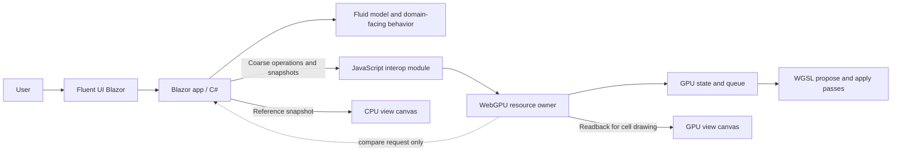
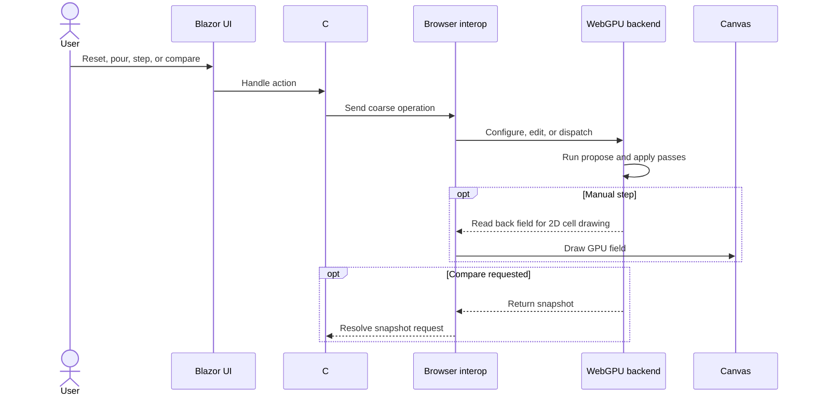

# WebGPU Fluid Sandbox

This directory now contains the first runnable implementation of the browser-based cellular-fluid workbench. It is a standalone Blazor WebAssembly application and has no code dependencies on the existing Granny's House Trials experiments; those experiments remain behavioral references only.

## At a glance

The workbench runs the cellular-fluid experiment using **Blazor WebAssembly** for the application shell and **WebGPU** for compute.

The aim is to make an early interactive iteration available for review. Broader success criteria and future simulation scope remain open.

| Direction | Current status |
| --- | --- |
| Browser application with Blazor WebAssembly | Implemented |
| Fluent UI Blazor controls around a visualization pane | Implemented |
| Cellular-fluid experiment first | Implemented |
| Chrome as the initial browser target | Supported target |
| Small, coarse-grained C#–browser GPU boundary | Implemented |
| C# CPU reference and GPU comparison | Implemented |
| JavaScript WebGPU backend with WGSL compute | Implemented |
| Linked height-aware CPU/GPU landscape views | Implemented with projected Canvas2D columns |
| GitHub Pages static deployment | Workflow included |

## First slice

The first implementation focuses on platform feasibility and the cellular-fluid simulation:

- Run/pause the GPU with an optional CPU reference, or manually advance one tick.
- Explore a downhill channel, lower collecting area, and a barrier with a lower spillway.
- Pour water uphill with the toolbar, or at a hovered cell with a right click.
- Draw additional barriers with right-drag; reset restores the starting terrain and clears water.
- Run the same synchronous cellular-flow rule in C# and WGSL.
- Let water leaving the grid drain from the four field boundaries.
- Compare CPU and GPU water snapshots on request using an absolute per-cell tolerance.
- Render linked height-aware landscapes with projected columns, retaining independent CPU/GPU water results.
- Keep the project independent of previous implementations. Existing code and measurements are references, not dependencies.

Advanced models such as MAC-grid simulation and the existing column-raycast renderer are later considerations. The cellular solver demonstrates redistribution, pooling, and overflow, not momentum-based waves.

## Navigation and controls

| Input | Behavior in either view |
| --- | --- |
| Left click | Select a cell and show terrain height plus CPU/GPU water depths |
| Left drag | Orbit around the terrain point under the initial press |
| Mouse wheel | Zoom relative to the hovered terrain point |
| Right click | Add 12 inches of water in a small brush at the pointed cell |
| Right drag | Preview a barrier stroke; release to raise its cells 12 inches above starting terrain |
| Horizontal landscape slider | Move both cameras sideways together |
| Vertical landscape slider, physically right of the views | Move both cameras along the other terrain axis |
| CPU reference: on/off | Suspend the reference; re-enable from a fresh GPU baseline |
| Ticks / display | Run 1, 2 (default), 4, or 8 ticks per display snapshot; manual Step remains one tick |

Selection, hover, barrier previews, and camera state are linked. A movement threshold distinguishes clicks from drags; canceling a gesture discards its pending edit. Overlapping barrier strokes do not repeatedly raise the same cells. Terrain edits preserve water depth rather than displacing water volume.

The overall page has a vertical scrollbar, wrapping controls, and stacked views on narrow screens. Use the wheel outside the views, the page margin, or the vertical scrollbar to scroll the page; the wheel over a view controls zoom. Touch-drag in a view orbits, while swiping outside the views scrolls the page. Mouse gestures remain necessary for right-button actions.

Run advances serialized batches paced by browser display opportunities, not a fixed 60 ms delay. Pause stops scheduling after any in-flight batch completes. Camera controls and selection remain usable while paused. Hidden tabs suspend scheduling; offscreen canvases are not drawn. Page scrolling does not move the shared camera, and both landscape sliders remain synchronized after anchored orbit/zoom.

**CPU reference off really suspends the reference:** no CPU solver steps, water-snapshot copies, canvas draws, or CPU summary scans. C# still owns terrain and brush/edit policy. Pours produce domain-defined additive deltas for the authoritative GPU without updating frozen CPU water; barriers still update C# terrain. CPU statistics and comparisons are unavailable while off. Re-enabling explicitly reads the current GPU field, imports its tick count, and announces a **new comparison baseline**. Only that action, reset, or explicit GPU-failure recovery may replace reference water; subsequent steps and pours remain independent.

When WebGPU is unavailable, Run/Step and terrain edits remain available on the CPU, and reference-off is disabled. Device loss/validation failure stops Run and recovers the **last completed display snapshot and its tick** into the CPU before exposing fallback controls. Unconfirmed GPU work or edits may be lost; a failed recovery explicitly resets the CPU instead of silently reviving stale reference water.

Reset commits cached water, terrain, and tick together only after the upload
completes. A partially failed reset invalidates recovery and explicitly resets the
CPU, rather than labeling previous water as tick zero on different terrain.
Pause and disposal explicitly resolve pending display waits before awaiting the
run loop; becoming hidden also cancels a pending animation-frame wait, including
the race where the tab hides immediately after scheduling.

## Conceptual boundary

The C# simulation owns terrain generation, barrier policy, water edits, reference state, statistics, and comparison policy. The browser GPU module owns WebGPU resources and dispatch; WGSL performs the numeric flow pass. A separate presentation module owns projection, picking, shared camera state, and gesture previews, without implementing simulation rules. Pours send additive water edits applied to each active implementation's own state; they never overwrite GPU water with the CPU reference. Reset uploads the complete starting field. GPU water is read back once per display batch and cached in JavaScript. Selection uses that display cache without another GPU readback or whole-field transfer to C#. Explicit comparison transfers the completed cache; reference re-enable requests a fresh readback.

The GPU buffer is the active compute state between edits. When enabled, the C# CPU model advances alongside it as an inspectable reference.

## Simulation and display loop

Each simulation action updates the active implementations. A batch dispatches all paired WGSL passes before one readback; the CPU delta buffer is reused across ticks. Unchanged terrain is not recopied through interop every tick. Camera gestures redraw visible, enabled views without advancing either solver. Terrain projection geometry and column order are reused until terrain/camera/viewport changes; hover redraws only when the hovered cell changes. Comparison reports mismatched cells, maximum absolute error, and total-water difference.

Performance readouts are sampled every 500 ms rather than rerendering the Blazor tree every tick:

- **CPU / GPU draw FPS:** actual completed Canvas2D redraws per view, not empty `requestAnimationFrame` callbacks. Paused, unchanged views settle to zero; camera interaction can still produce redraws.
- **Ticks/sec:** completed simulation ticks, not display frames (a batch may contain several).
- **Draw ms:** wall-clock Canvas2D submission time per actual redraw, not compositor/presentation latency.
- **CPU step ms/tick:** most recent reference batch's solver time divided by tick count; `off` when suspended.
- **GPU dispatch + readback ms/batch:** most recent interop/dispatch/map roundtrip, including queue wait and data transfer. **Not GPU execution time** or a timestamp-query benchmark.

The low-frequency readout timer is not an animation loop. While paused there is no continuous redraw loop, dispatch, or readback. Readouts are suppressed in hidden tabs.

An exploratory headless Chromium/SwiftShader comparison used the same 1368×912
viewport, 96×64 starting terrain, and 588 cell-inch uphill pour. Over roughly eight
seconds, the original revision completed about 12 ticks; the updated paired mode
completed about 86 with its default two-tick batches, and GPU-only mode about 172.
A one-tick updated run completed about 44 ticks, separating some of the benefit
from batching. These are sampled development observations, **not hardware
benchmarks or promised frame rates**: software GPU/headless scheduling, in-flight
batches, and readout sampling affect them. CPU-off recorded zero CPU draws;
selection added zero GPU maps; paused unchanged views recorded zero draws/maps.
Responsive checks covered 1368×912 and 912×1368 Surface-like viewports plus
390×844 and 320×720; this was not physical Surface/touch hardware validation.

## Rendering context

The existing experiment is useful as behavioral and rendering reference, but it is not a dependency. Its renderer uses a full-screen triangle and a pixel-shader raycast that traverses variable-height columns with DDA, rather than first building a conventional terrain mesh. Terrain height and fractional water depth are separate inputs to the derived water surface and shading.

The browser uses **Canvas2D-projected height columns** with a shared orbit camera and terrain picking. Both implementations use the same presentation path, so the GPU label denotes fluid compute rather than a separate GPU renderer. The WebGPU state is read back for drawing after each batch. GPU-resident rendering and recreating the column-raycast renderer in WGSL remain future options. Existing D3D12 work provides behavior and rendering references, not code dependencies.

### Workers and GitHub Pages

Ordinary dedicated JavaScript workers with message passing do **not** inherently require COOP/COEP or `SharedArrayBuffer`; a static Pages app can serve same-origin worker scripts. Moving this C# reference into one is not simply wrapping the existing object in a worker: it needs a separately bootstrapped .NET runtime/worker entry, serialized edit/baseline ownership, cancellation, and measured transfer costs. A WebGPU worker would need browser capability checks and its own device/resource lifetime; an existing `GPUDevice` cannot simply be transferred. OffscreenCanvas availability and rendering costs are separate concerns.

Shared-memory WebAssembly/browser threads require cross-origin isolation and compatible runtime/build support. This Pages deployment does **not** configure COOP/COEP and must not assume them; no service-worker header workaround or multithreading dependency is introduced. Worker isolation is feasible future work if profiling justifies it, not a prerequisite or an implemented performance claim. CPU/GPU simulation remains serialized; there is no speculative mixed-solver overlap.

## Open decisions

The companion documents hold the implementation decisions and follow-up questions. The main unresolved choices include:

- What visual or interaction qualities should be improved after reviewing the first iteration.
- Whether a faster GPU-resident rendering path is warranted after the cell-map experiment.
- Which future models or browser targets are worth adding.

## Project documents

- [Architecture decisions](./ARCHITECTURE_DECISIONS.md) — decisions and implemented component boundaries.
- [Questions and answers](./QUESTIONS_AND_ANSWERS.md) — recorded clarifications and remaining questions.
- [Deferred to-do ledger](./DEFERRED_TODO.md) — follow-up work intentionally outside the first slice.

## Run and validate

- Run locally with `dotnet run --project projects/grannys-house-trials/webgpu-fluid-sandbox/WebGpuFluidSandbox.csproj`.
- Run the CPU model checks with `dotnet run --project projects/grannys-house-trials/webgpu-fluid-sandbox/tests/FluidModelChecks/FluidModelChecks.csproj`.
- Publish static files with `dotnet publish projects/grannys-house-trials/webgpu-fluid-sandbox/WebGpuFluidSandbox.csproj --configuration Release`.
- The GitHub Actions workflow publishes the app to GitHub Pages from `main`; set the repository's Pages source to **GitHub Actions** once in repository settings.
- WebGPU requires a supporting browser and a secure context. When it is unavailable, the C# CPU model remains available.
- Keep domain concepts in C#, browser GPU/resource work in the JavaScript module, and interop coarse-grained.
