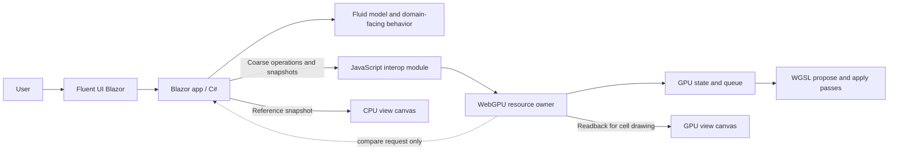
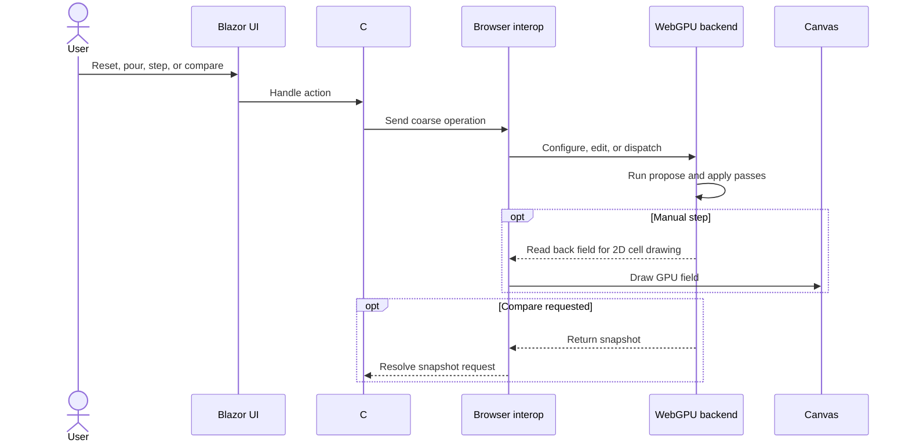

# WebGPU Fluid Sandbox

This directory now contains the first runnable implementation of the browser-based cellular-fluid workbench. It is a standalone Blazor WebAssembly application and has no code dependencies on the existing Granny's House Trials experiments; those experiments remain behavioral references only.

## At a glance

The workbench runs the cellular-fluid experiment using **Blazor WebAssembly** for the application shell and **WebGPU** for compute.

The aim is to make an early interactive iteration available for review. Broader success criteria and future simulation scope remain open.

| Direction | Current status |
| --- | --- |
| Browser application with Blazor WebAssembly | Implemented |
| Fluent UI Blazor controls around a visualization pane | Implemented |
| Cellular-fluid experiment first | Implemented |
| Chrome as the initial browser target | Supported target |
| Small, coarse-grained C#–browser GPU boundary | Implemented |
| C# CPU reference and GPU comparison | Implemented |
| JavaScript WebGPU backend with WGSL compute | Implemented |
| Linked height-aware CPU/GPU landscape views | Implemented with projected Canvas2D columns |
| GitHub Pages static deployment | Workflow included |

## First slice

The first implementation focuses on platform feasibility and the cellular-fluid simulation:

- Run/pause both implementations or manually advance one tick.
- Explore a downhill channel, lower collecting area, and a barrier with a lower spillway.
- Pour water uphill with the toolbar, or at a hovered cell with a right click.
- Draw additional barriers with right-drag; reset restores the starting terrain and clears water.
- Run the same synchronous cellular-flow rule in C# and WGSL.
- Let water leaving the grid drain from the four field boundaries.
- Compare CPU and GPU water snapshots on request using an absolute per-cell tolerance.
- Render linked height-aware landscapes with projected columns, retaining independent CPU/GPU water results.
- Keep the project independent of previous implementations. Existing code and measurements are references, not dependencies.

Advanced models such as MAC-grid simulation and the existing column-raycast renderer are later considerations. The cellular solver demonstrates redistribution, pooling, and overflow, not momentum-based waves.

## Navigation and controls

| Input | Behavior in either view |
| --- | --- |
| Left click | Select a cell and show terrain height plus CPU/GPU water depths |
| Left drag | Orbit around the terrain point under the initial press |
| Mouse wheel | Zoom relative to the hovered terrain point |
| Right click | Add 12 inches of water in a small brush at the pointed cell |
| Right drag | Preview a barrier stroke; release to raise its cells 12 inches above starting terrain |
| Horizontal landscape slider | Move both cameras sideways together |

Selection, hover, barrier previews, and camera state are linked. A movement threshold distinguishes clicks from drags; canceling a gesture discards its pending edit. Overlapping barrier strokes do not repeatedly raise the same cells. Terrain edits preserve water depth rather than displacing water volume.

The overall page has a vertical scrollbar, wrapping controls, and stacked views on narrow screens. Use the wheel outside the views, the page margin, or the vertical scrollbar to scroll the page; the wheel over a view controls zoom. Touch-drag in a view orbits, while swiping outside the views scrolls the page. Mouse gestures remain necessary for right-button actions.

Run advances paired ticks sequentially without overlapping GPU readbacks. Pause stops scheduling ticks after any in-flight tick completes. Camera controls and selection remain usable while paused. When WebGPU is unavailable, Run/Step and terrain edits remain available on the CPU.

## Conceptual boundary

The C# simulation owns terrain generation, barrier policy, water edits, reference state, statistics, and comparison policy. The browser GPU module owns WebGPU resources and dispatch; WGSL performs the numeric flow pass. A separate presentation module owns projection, picking, shared camera state, and gesture previews, without implementing simulation rules. Pours send additive water edits applied to each implementation's own state; they never overwrite GPU water with the CPU reference. Reset uploads the complete starting field. GPU water is read back to JavaScript for drawing after each step; snapshots return to C# for explicit comparison and selected-cell readouts.

The GPU buffer is the active compute state between edits. The C# CPU model advances alongside it as an inspectable reference.

## Simulation and display loop

Each simulation action updates both implementations and refreshes their landscapes. Camera gestures redraw both without advancing either solver. Comparison requests read back the GPU state and report mismatched cells, maximum absolute error, and total-water difference.

## Rendering context

The existing experiment is useful as behavioral and rendering reference, but it is not a dependency. Its renderer uses a full-screen triangle and a pixel-shader raycast that traverses variable-height columns with DDA, rather than first building a conventional terrain mesh. Terrain height and fractional water depth are separate inputs to the derived water surface and shading.

The browser uses **Canvas2D-projected height columns** with a shared orbit camera and terrain picking. Both implementations use the same presentation path, so the GPU label denotes fluid compute rather than a separate GPU renderer. The WebGPU state is read back for drawing after each step. GPU-resident rendering and recreating the column-raycast renderer in WGSL remain future options. Existing D3D12 work provides behavior and rendering references, not code dependencies.

## Open decisions

The companion documents hold the implementation decisions and follow-up questions. The main unresolved choices include:

- What visual or interaction qualities should be improved after reviewing the first iteration.
- Whether a faster GPU-resident rendering path is warranted after the cell-map experiment.
- Which future models or browser targets are worth adding.

## Project documents

- [Architecture decisions](./ARCHITECTURE_DECISIONS.md) — decisions and implemented component boundaries.
- [Questions and answers](./QUESTIONS_AND_ANSWERS.md) — recorded clarifications and remaining questions.
- [Deferred to-do ledger](./DEFERRED_TODO.md) — follow-up work intentionally outside the first slice.

## Run and validate

- Run locally with `dotnet run --project projects/grannys-house-trials/webgpu-fluid-sandbox/WebGpuFluidSandbox.csproj`.
- Run the CPU model checks with `dotnet run --project projects/grannys-house-trials/webgpu-fluid-sandbox/tests/FluidModelChecks/FluidModelChecks.csproj`.
- Publish static files with `dotnet publish projects/grannys-house-trials/webgpu-fluid-sandbox/WebGpuFluidSandbox.csproj --configuration Release`.
- The GitHub Actions workflow publishes the app to GitHub Pages from `main`; set the repository's Pages source to **GitHub Actions** once in repository settings.
- WebGPU requires a supporting browser and a secure context. When it is unavailable, the C# CPU model remains available.
- Keep domain concepts in C#, browser GPU/resource work in the JavaScript module, and interop coarse-grained.
