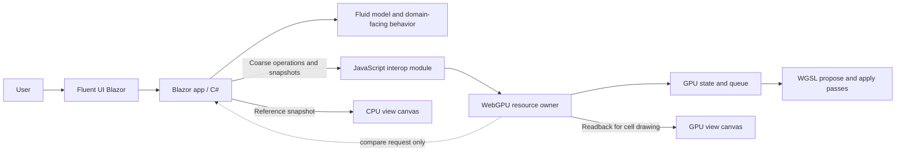
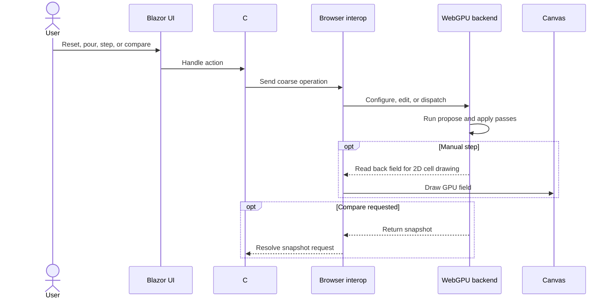

# WebGPU Fluid Sandbox

This directory now contains the first runnable implementation of the browser-based cellular-fluid workbench. It is a standalone Blazor WebAssembly application and has no code dependencies on the existing Granny's House Trials experiments; those experiments remain behavioral references only.

## At a glance

The workbench runs the cellular-fluid experiment using **Blazor WebAssembly** for the application shell and **WebGPU** for compute.

The aim is to make an early interactive iteration available for review. Broader success criteria and future simulation scope remain open.

| Direction | Current status |
| --- | --- |
| Browser application with Blazor WebAssembly | Implemented |
| Fluent UI Blazor controls around a visualization pane | Implemented |
| Cellular-fluid experiment first | Implemented |
| Chrome as the initial browser target | Supported target |
| Small, coarse-grained C#–browser GPU boundary | Implemented |
| C# CPU reference and GPU comparison | Implemented |
| JavaScript WebGPU backend with WGSL compute | Implemented |
| Simple 2D cell visualization | Implemented; raycast rendering deferred |
| GitHub Pages static deployment | Workflow included |

## First slice

The first implementation focuses on platform feasibility and the cellular-fluid simulation:

- Reset the field, pour water into its center, and manually advance one tick.
- Run the same synchronous cellular-flow rule in C# and WGSL.
- Let water leaving the grid drain from the four field boundaries.
- Compare CPU and GPU water snapshots on request using an absolute per-cell tolerance.
- Render side-by-side cell maps with regular 2D drawing.
- Keep the project independent of previous implementations. Existing code and measurements are references, not dependencies.

Advanced models such as MAC-grid simulation, a broad sandbox workflow, and the existing column-raycast renderer are later considerations.

## Conceptual boundary

The C# simulation owns the domain-facing model, reference state, user operations, statistics, and comparison policy. The browser module owns WebGPU resources and dispatch; WGSL performs the numeric flow pass. A user action crosses the C#/JavaScript boundary once, with whole-field uploads on reset and pour. The GPU view is read back to JavaScript for drawing after each manual step; CPU/GPU data is returned to C# only when comparison is requested.

The GPU buffer is the active compute state between edits. The C# CPU model advances alongside it as an inspectable reference.

## Simulation and display loop

Each control action updates both implementations and refreshes their cell maps. Comparison requests read back the GPU state and report mismatched cells, maximum absolute error, and total-water difference.

## Rendering context

The existing experiment is useful as behavioral and rendering reference, but it is not a dependency. Its renderer uses a full-screen triangle and a pixel-shader raycast that traverses variable-height columns with DDA, rather than first building a conventional terrain mesh. Terrain height and fractional water depth are separate inputs to the derived water surface and shading.

The first browser iteration uses **regular 2D cell rendering** while the simulation is established. The WebGPU state is read back to JavaScript for drawing after each manual step. Recreating the column-raycast renderer in WGSL may be explored later. Existing D3D12 work provides behavior and rendering references, not code dependencies.

## Open decisions

The companion documents hold the implementation decisions and follow-up questions. The main unresolved choices include:

- What visual or interaction qualities should be improved after reviewing the first iteration.
- Whether a faster GPU-resident rendering path is warranted after the cell-map experiment.
- Which future models or browser targets are worth adding.

## Project documents

- [Architecture decisions](./ARCHITECTURE_DECISIONS.md) — decisions and implemented component boundaries.
- [Questions and answers](./QUESTIONS_AND_ANSWERS.md) — recorded clarifications and remaining questions.
- [Deferred to-do ledger](./DEFERRED_TODO.md) — follow-up work intentionally outside the first slice.

## Run and validate

- Run locally with `dotnet run --project projects/grannys-house-trials/webgpu-fluid-sandbox/WebGpuFluidSandbox.csproj`.
- Run the CPU model checks with `dotnet run --project projects/grannys-house-trials/webgpu-fluid-sandbox/tests/FluidModelChecks/FluidModelChecks.csproj`.
- Publish static files with `dotnet publish projects/grannys-house-trials/webgpu-fluid-sandbox/WebGpuFluidSandbox.csproj --configuration Release`.
- The GitHub Actions workflow publishes the app to GitHub Pages from `main`; set the repository's Pages source to **GitHub Actions** once in repository settings.
- WebGPU requires a supporting browser and a secure context. When it is unavailable, the C# CPU model remains available.
- Keep domain concepts in C#, browser GPU/resource work in the JavaScript module, and interop coarse-grained.
